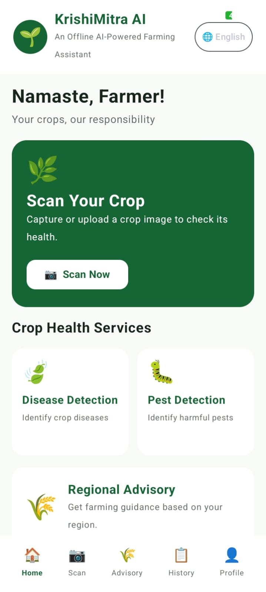
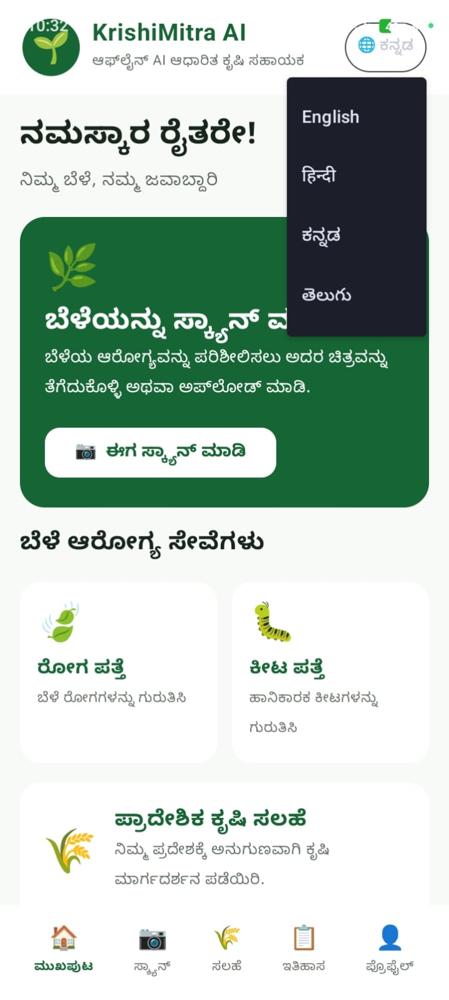
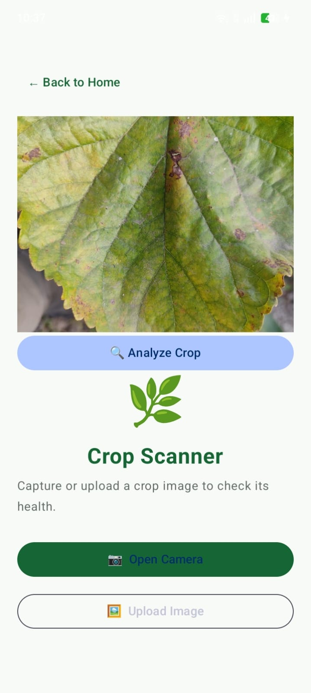
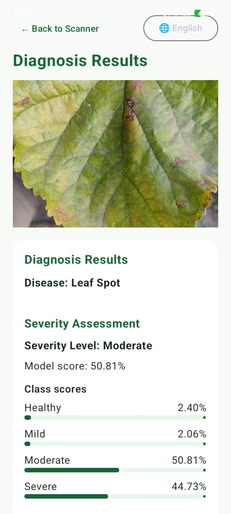
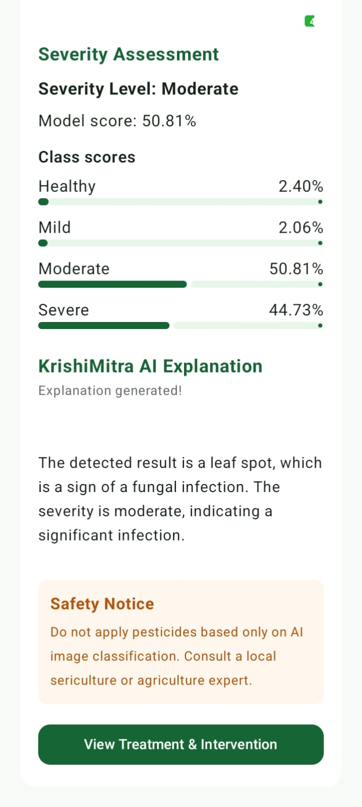
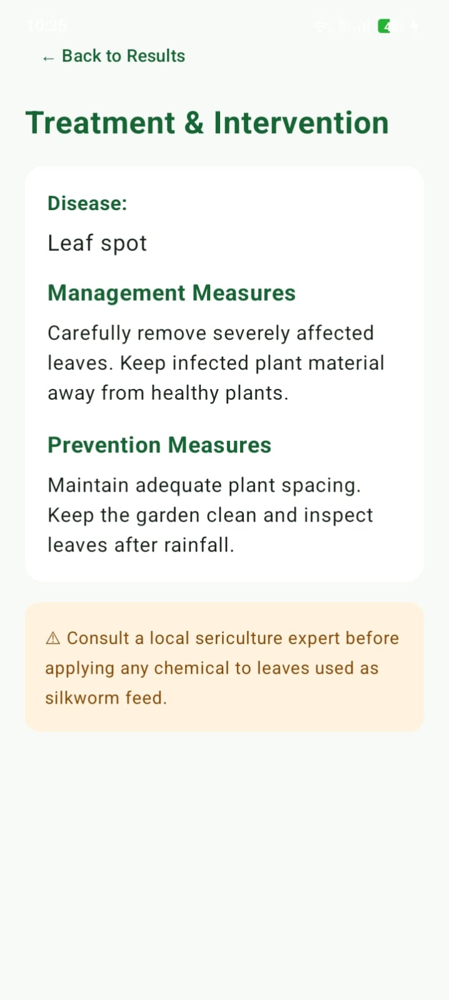
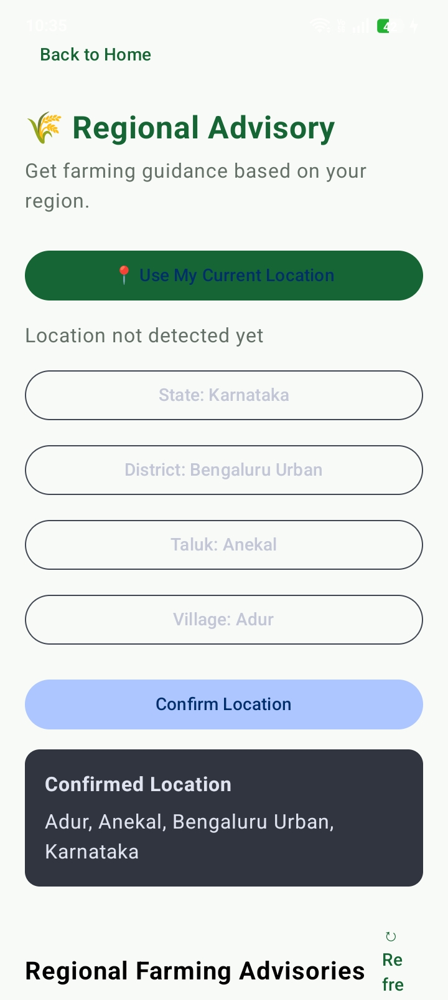
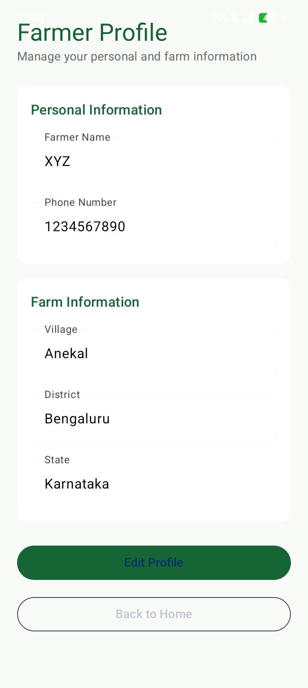
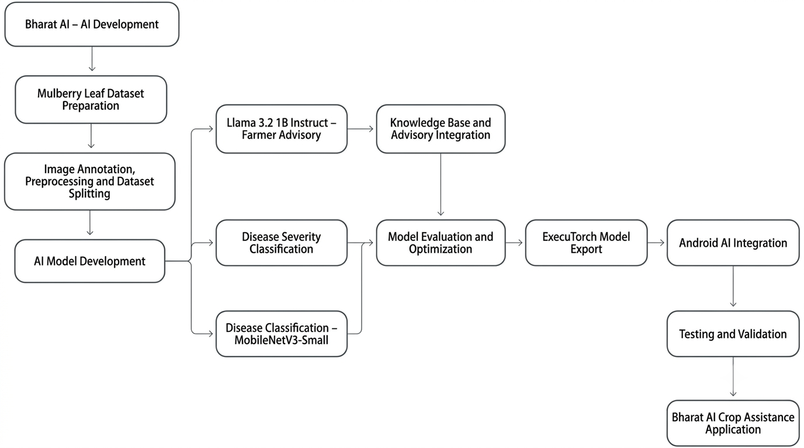
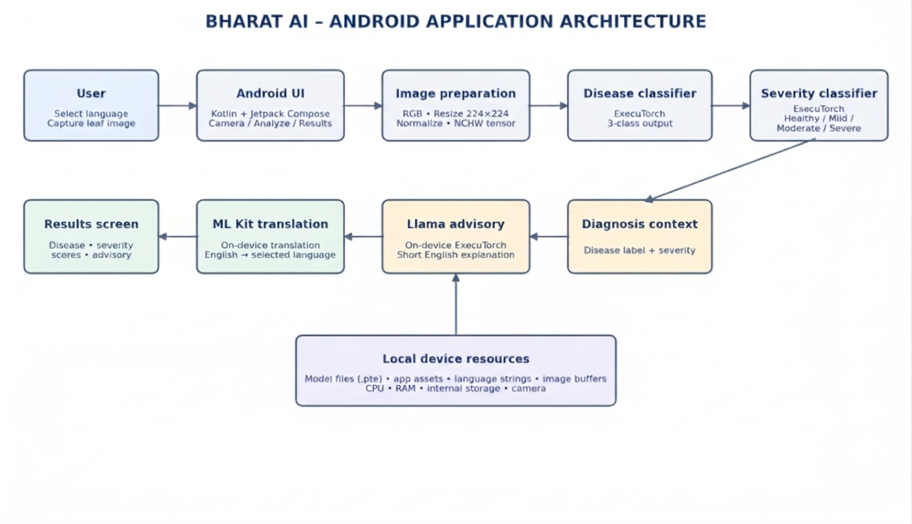

# KrishiMitra AI

### An Offline AI-Powered Farming Assistant

KrishiMitra AI is an AI-powered farming assistant designed to help farmers identify crop diseases and assess disease severity using leaf images. The application operates on-device, reducing dependence on internet connectivity and enabling accessible crop health assistance.

The project combines computer vision, on-device AI inference, and multilingual farmer-friendly explanations in a mobile application.

## Problem Statement

Develop an AI-powered assistant that helps farmers identify crop diseases, detect pests, and receive actionable recommendations, running entirely on-device without internet connectivity.

## Key Features

- **Crop Disease Detection:** Identifies mulberry leaf conditions using an AI image classification model.
- **Severity Assessment:** Evaluates leaf condition across four severity levels: Healthy, Mild, Moderate, and Severe.
- **AI-Powered Explanations:** Uses an on-device Llama model to generate simple explanations of diagnosis results.
- **Multilingual Interface:** Supports English, Hindi, Kannada, and Telugu.
- **Offline Operation:** Performs image analysis and advisory generation locally on the device.
- **Treatment and Intervention:** Provides disease-related management and prevention guidance.
- **Regional Advisory:** Provides a location-based agricultural advisory interface.
- **Farmer Profile:** Allows farmers to maintain personal and farm information.

## AI Models

### 1. Disease Classification
- Architecture: MobileNetV3-Small
- Framework: PyTorch
- Task: Mulberry leaf disease classification
- Classes: Disease Free, Leaf Rust, and Leaf Spot
- Deployment: ExecuTorch

### 2. Severity Classification
- Architecture: MobileNetV3-Small
- Framework: PyTorch
- Task: Mulberry leaf severity assessment
- Classes: Healthy, Mild, Moderate, and Severe
- Deployment: ExecuTorch

### 3. AI Advisory Model
- Model family: Llama 3.2
- Model size: 1B Instruct
- Runtime: ExecuTorch
- Purpose: Generate farmer-friendly explanations from disease and severity results.

## Technology Stack

| Component | Technology |
|---|---|
| Android Development | Kotlin |
| UI Framework | Jetpack Compose |
| Disease Classification | MobileNetV3-Small |
| Severity Classification | MobileNetV3-Small |
| AI Advisory | Llama 3.2 1B Instruct |
| On-device Inference | ExecuTorch |
| Advisory Translation | Google ML Kit |
| Development Environment | Android Studio |
| Version Control | Git and GitHub |

## Supported Languages

- English
- Hindi
- Kannada
- Telugu

## Application Architecture

The application follows an on-device processing workflow:

1. Farmer captures or selects a mulberry leaf image.
2. The Android application prepares the image for inference.
3. The disease classification model identifies the leaf condition.
4. The severity model assesses the condition.
5. The diagnosis information is passed to the Llama advisory model.
6. The generated explanation is translated into the selected application language when required.
7. The diagnosis and advisory are displayed to the farmer.

## Application Screenshots

The following screenshots showcase the working KrishiMitra AI Android application and its major features.

### 1. Home Screen



### 2. Language Selection



### 3. Crop Scanning



### 4. Disease Detection Results



### 6. Llama AI-Powered Advisory



### 7. Treatment Recommendations



### 8. Regional Agricultural Advisory



### 9. Farmer Profile



## Target Device

- Test Device: Samsung Galaxy A35 5G
- Operating System: Android 16
- Platform: Android

## Repository Structure

```text
KrishiMitra-AI/
│
├── AI-Models/
│   └── Disease and severity classification models
│
├── Agricultural-Database/
│   └── Agricultural advisory data
│
├── Android-App/
│   └── Android application source code
│
├── Demo/
│   └── Project demonstration materials
│
├── Documentation/
│   └── Project reports and technical documentation
│
├── Testing/
│   └── Model and application testing resources
│
└── README.md
```

## Main Android Application Source Code

The main Android application source code, including Kotlin files for the user interface, disease classification, severity assessment, Llama advisory, image preprocessing, and other application components, is available here:

**[Explore Main Android Application Source Code](Android-App/BharatAI/app/src/main/java/com/bharatai/cropassistant/)**

## Limitations

- Current crop disease detection is focused on mulberry leaves.
- Model predictions depend on image quality and the training dataset.
- AI-generated explanations should be treated as guidance, not a replacement for expert agricultural advice.
- The regional advisory interface depends on the availability of verified regional data.
- The current pest detection feature is not yet implemented as a trained on-device detection model.

## Future Enhancements

- Expand disease detection to additional crops.
- Integrate a dedicated pest detection model.
- Improve severity classification using larger, expert-verified datasets.
- Expand multilingual AI generation capabilities.
- Enhance regional agricultural recommendations.
- Conduct broader field testing across different farming environments.

## Project Objective

KrishiMitra AI aims to make AI-assisted crop health analysis more accessible to farmers through an offline-first, multilingual Android application.

## Project Architecture and Workflow

### 1. AI Model Development Workflow



This diagram illustrates the development workflow, including dataset preparation, image annotation, disease and severity classification, Llama-based farmer advisory, model evaluation, ExecuTorch export, and Android integration.

### 2. Android Application Architecture



This diagram illustrates the on-device application workflow, from image capture and preprocessing to disease detection, severity assessment, AI-generated explanations, multilingual translation, and result presentation.

---

**KrishiMitra AI — An Offline AI-Powered Farming Assistant**
